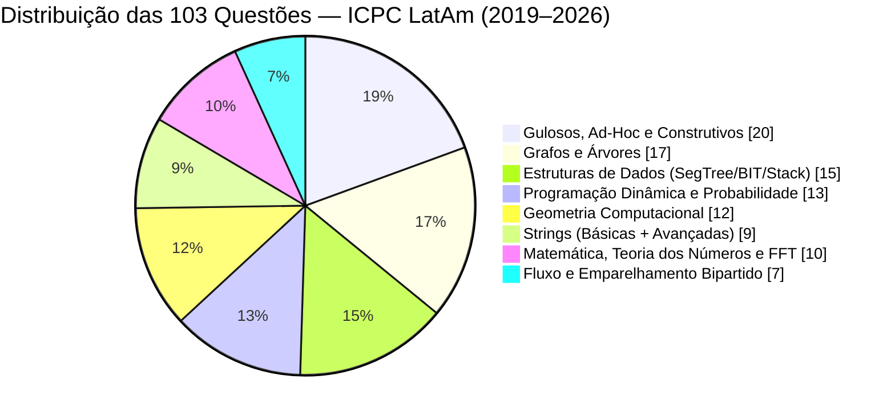
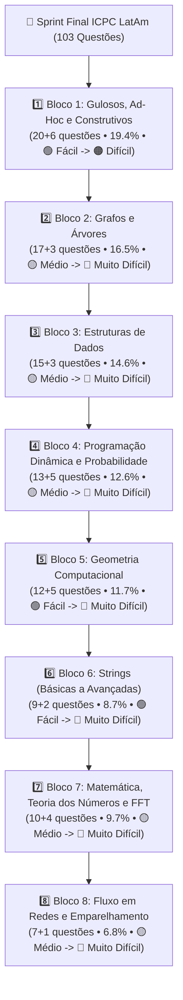

# 📊 Painel Visual — Raio-X ICPC LatAm (2019–2026)

Resumo visual completo das **103 questões** analisadas nas 8 edições da Regional Latino-Americana do ICPC (**2019, 2020, 2021, 2022, 2023, 2024, 2025 e 2026**).

---

## 1. Quadros Resumo (ASCII / Terminal)

### 📌 Distribuição Geral por Tópico Principal (103 Questões)

```text
╔════════════════════════════════════════════════════════════════════════╗
║       📊 RAIO-X ICPC LATAM / NACIONAL (2019–2026) • 103 QUESTÕES       ║
╠════════════════════════════╦══════════════════════════════╦════════════╣
║ TÓPICO PRINCIPAL           ║ FREQUÊNCIA NAS 8 PROVAS      ║ QTD (%)    ║
╠════════════════════════════╬══════════════════════════════╬════════════╣
║ 1. Gulosos, Ad-Hoc, Const. ║ ████████████████████████     ║ 20 (19.4%) ║
║ 2. Grafos e Árvores        ║ ████████████████████         ║ 17 (16.5%) ║
║ 3. Estruturas de Dados     ║ ██████████████████           ║ 15 (14.6%) ║
║ 4. Prog. Dinâmica e Prob.  ║ ████████████████             ║ 13 (12.6%) ║
║ 5. Geometria Computacional ║ ██████████████               ║ 12 (11.7%) ║
║ 6. Strings (Bás. + Avanç.) ║ ███████████                  ║  9 ( 8.7%) ║
║ 7. Matemática, TN e FFT    ║ ████████████                 ║ 10 ( 9.7%) ║
║ 8. Fluxo e Matching        ║ ████████                     ║  7 ( 6.8%) ║
╠════════════════════════════╩══════════════════════════════╩════════════╣
║ TOTAL EXATO: 103 questões (13+14+13+13+13+12+12+13) em 8 edições       ║
╚════════════════════════════════════════════════════════════════════════╝
```

### 🔄 Comparativo de Tendência: Passado (2019–2022) vs. Recente (2023–2026)

```text
╔════════════════════════════════════════════════════════════════════════╗
║          🔄 MUDANÇA DE TENDÊNCIA: PASSADO vs. PROVAS RECENTES          ║
╠══════════════════════╦════════════════════════╦════════════════════════╣
║ TEMA                 ║ PASSADO (2019–2022)    ║ RECENTE (2023–2026)    ║
║                      ║ 4 Provas (53 questões) ║ 4 Provas (50 questões) ║
╠══════════════════════╬════════════════════════╬════════════════════════╣
║ 🕸️ Grafos e Árvores  ║ ████░ (8 questões)     ║ █████ (9 questões 🚀)  ║
║    Foco:             ║ Tree Hash (21G, 22F),  ║ Centroid, Rerooting,   ║
║                      ║ BFS Grid/Tempo (21C)   ║ Pontes/Ciclos, Euler   ║
╠══════════════════════╬════════════════════════╬════════════════════════╣
║ 🌲 Estrut. de Dados  ║ ████░ (7 questões)     ║ █████ (8 questões 🚀)  ║
║    Foco:             ║ Pilha Monotônica +     ║ CHT/Li Chao, XOR Hash, ║
║                      ║ SegTree Lazy (21D)     ║ Sqrt DAG, BIT+Parábola ║
╠══════════════════════╬════════════════════════╬════════════════════════╣
║ 🔢 Mat., TN e FFT    ║ ██░░░ (3 questões)     ║ █████ (7 questões 🚀)  ║
║    Foco:             ║ Polinômios (19K),      ║ Pollard Rho, Totiente, ║
║                      ║ FFT/NTT (21B), Bits    ║ Ordem Mult., Inversões ║
╠══════════════════════╬════════════════════════╬════════════════════════╣
║ 📐 Geometria         ║ █████ (7 questões)     ║ ████░ (5 questões)     ║
║    Foco:             ║ Sweep Radial (21A),    ║ Manhattan 45°, Círculo,║
║                      ║ Minkowski, DP Radial   ║ Sombras 1D, Parábola   ║
╠══════════════════════╬════════════════════════╬════════════════════════╣
║ 🌊 Fluxo / Matching  ║ ████░ (5 questões)     ║ ██░░░ (2 questões +1)  ║
║    Foco:             ║ Dinic, Dilworth,       ║ Grafo de Linha (24D),  ║
║                      ║ Húngaro (21H), Matching║ Dual Planar+Ternária   ║
╠══════════════════════╬════════════════════════╬════════════════════════╣
║ 🔤 Strings           ║ ████░ (4 questões)     ║ ████░ (5 questões)     ║
║    Foco:             ║ Suffix Automaton (2x), ║ 4 Warm-ups fáceis +    ║
║                      ║ Z-Func + 1 Warm-up(21K)║ Parsing (23L)          ║
╚══════════════════════╩════════════════════════╩════════════════════════╝
```

---

## 2. Gráficos Mermaid Nativos (GitHub / Obsidian / VS Code / Notion)

### 🥧 Proporção das 103 Questões por Tópico Principal (2019–2026)



### 📈 Evolução por Período: Passado (2019–2022: 4 anos) vs. Recente (2023–2026: 4 anos)

> **Legenda das Barras:**
>
> - **1ª Barra (Esquerda):** Provas de **2019, 2020, 2021 e 2022** (53 questões)
> - **2ª Barra (Direita):** Provas de **2023, 2024, 2025 e 2026** (50 questões)

```mermaid
xychart-beta
    title "Comparativo Absoluto: Passado (2019-2022) vs Recente (2023-2026)"
    x-axis ["Gulosos/AdHoc", "Grafos/Arvores", "Estrut. Dados", "DP/Prob", "Geometria", "Strings", "Mat/TN/FFT", "Fluxo/Match"]
    y-axis "Quantidade de Questões" 0 --> 12
    bar [11, 8, 7, 8, 7, 4, 3, 5]
    bar [9, 9, 8, 5, 5, 5, 7, 2]
```



### 🗺️ Trilha de Estudo de Menor Troca de Contexto (Ordem do `QUESTÕES.md`)


