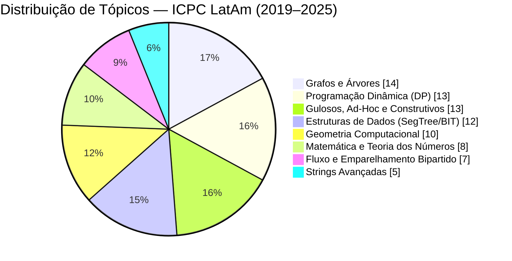

# 📊 Painel Visual — Raio-X ICPC LatAm (2019–2025)

Resumo visual das **77 questões** analisadas nas últimas 6 edições da Regional Latino-Americana do ICPC (2019, 2020, 2022, 2023, 2024 e 2025).

---

## 1. Quadros Resumo (ASCII / Terminal)

### 📌 Distribuição Geral por Tópico Principal

```text
╔══════════════════════════════════════════════════════════════════════╗
║       📊 RAIO-X ICPC LATAM / NACIONAL (2019–2025) • 77 QUESTÕES      ║
╠══════════════════════════╦══════════════════════════════╦════════════╣
║ TÓPICO PRINCIPAL         ║ FREQUÊNCIA NAS 6 PROVAS      ║ QTD (%)    ║
╠══════════════════════════╬══════════════════════════════╬════════════╣
║ 1. Grafos e Árvores      ║ ████████████████████         ║ 14 (18.2%) ║
║ 2. Prog. Dinâmica (DP)   ║ ███████████████████          ║ 13 (16.9%) ║
║ 3. Gulosos e Ad-Hoc      ║ ███████████████████          ║ 13 (16.9%) ║
║ 4. Estruturas de Dados   ║ █████████████████            ║ 12 (15.6%) ║
║ 5. Geometria Comp.       ║ ██████████████               ║ 10 (13.0%) ║
║ 6. Matemática e Teo. Num.║ ███████████                  ║  8 (10.4%) ║
║ 7. Fluxo e Matching      ║ ██████████                   ║  7 ( 9.1%) ║
║ 8. Strings Avançadas*    ║ ███████                      ║  5 ( 6.5%) ║
╠══════════════════════════╩══════════════════════════════╩════════════╣
║ *Strings Básicas/Warm-up somam mais 4 questões (Total = 77 + 5 duplas)║
╚══════════════════════════════════════════════════════════════════════╝
```

### 🔄 Comparativo de Tendência: Passado vs. Recente

```text
╔══════════════════════════════════════════════════════════════════════╗
║         🔄 MUDANÇA DE TENDÊNCIA: PASSADO vs. PROVAS RECENTES         ║
╠══════════════════════╦═══════════════════════╦═══════════════════════╣
║ TEMA                 ║ PASSADO (2019–2022)   ║ RECENTE (2023–2025)   ║
╠══════════════════════╬═══════════════════════╬═══════════════════════╣
║ 🕸️ Grafos e Árvores  ║ ███░░ (Moderado)      ║ █████ (EM ALTA! 🚀)   ║
║    Foco:             ║ DAGs, BFS em Grid     ║ Centroid, Rerooting,  ║
║                      ║                       ║ Pontes/Ciclos, Euler  ║
╠══════════════════════╬═══════════════════════╬═══════════════════════╣
║ 🔢 Teoria dos Números║ ██░░░ (Baixo)         ║ █████ (EXPLODIU! 🚀)  ║
║    Foco:             ║ Base 2, Polinômios    ║ Pollard Rho, Totiente,║
║                      ║                       ║ Combinatória, Divisib.║
╠══════════════════════╬═══════════════════════╬═══════════════════════╣
║ 📐 Geometria         ║ █████ (Polígonos)     ║ ████░ (Analítica+ED)  ║
║    Foco:             ║ Minkowski, DP Radial  ║ CHT, Manhattan 45°,   ║
║                      ║                       ║ Parábola+BIT, Círculo ║
╠══════════════════════╬═══════════════════════╬═══════════════════════╣
║ 🌊 Fluxo / Matching  ║ ████░ (Direto)        ║ ████░ (Camuflado 🕵️)  ║
║    Foco:             ║ Dinic, Dilworth,      ║ Grafo de Linha (24 D),║
║                      ║ Matching em Árvore    ║ Dual Planar+Ternária  ║
╠══════════════════════╬═══════════════════════╬═══════════════════════╣
║ 🔤 Strings Avançadas ║ ████░ (Pesado)        ║ █░░░░ (DESABOU! 📉)   ║
║    Foco:             ║ Suffix Automaton (2x),║ Virou Warm-up fácil   ║
║                      ║ Z-Function            ║ ou XOR Hashing (23 C) ║
╠══════════════════════╬═══════════════════════╬═══════════════════════╣
║ 🧩 Matroides (Geral) ║ ░░░░░ (0 questões)    ║ ░░░░░ (0 questões)    ║
║    Veredito:         ║ Usar p/ Gulosos e XOR; focar código em Fluxo! ║
╚══════════════════════╩═══════════════════════╩═══════════════════════╝
```

---

## 2. Gráficos Mermaid Nativo (Obsidian / GitHub / Notion)

### 🥧 Proporção de Tópicos (2019–2025)



### 📈 Evolução por Período: Passado (2019–2022) vs. Recente (2023–2025)

> **Legenda das Barras:**
>
> - **1ª Barra (Esquerda):** Provas de **2019, 2020 e 2022**
> - **2ª Barra (Direita):** Provas de **2023, 2024 e 2025**

```mermaid
xychart-beta
    title "Evolução de Questões: Passado (19-22) vs Recente (23-25)"
    x-axis ["Grafos/Árvores", "Teo. Números/Mat", "Geometria", "Fluxo/Matching", "Strings Avançadas", "Interseção Matroide"]
    y-axis "Quantidade de Questões" 0 --> 10
    bar [5, 2, 6, 4, 3, 0]
    bar [9, 6, 4, 3, 2, 0]
```



---

## 3. Gráficos Interativos Embarcados (HTML / Mermaid Live)

<script src="https://mermaid.live/embed.js" async></script>

### 🥧 Visualização Interativa — Distribuição Geral

<mermaid-embed src="https://mermaid.live/embed?theme=dark&look=classic&mode=dark&controls=0&grid=0" height="480">
pie showData
    title Distribuição de Tópicos — ICPC LatAm (2019–2025)
    "Grafos e Árvores" : 14
    "Programação Dinâmica (DP)" : 13
    "Gulosos, Ad-Hoc e Construtivos" : 13
    "Estruturas de Dados (SegTree/BIT)" : 12
    "Geometria Computacional" : 10
    "Matemática e Teoria dos Números" : 8
    "Fluxo e Emparelhamento Bipartido" : 7
    "Strings Avançadas" : 5
</mermaid-embed>

### 📊 Visualização Interativa — Passado (1ª Barra) vs. Recente (2ª Barra)

<mermaid-embed src="https://mermaid.live/embed?theme=dark&look=classic&mode=dark&controls=0&grid=0" height="480">
xychart-beta
    title "Evolução de Questões: Passado (19-22) vs Recente (23-25)"
    x-axis ["Grafos/Árvores", "Teo. Números/Mat", "Geometria", "Fluxo/Matching", "Strings Avançadas", "Interseção Matroide"]
    y-axis "Quantidade de Questões" 0 --> 10
    bar [5, 2, 6, 4, 3, 0]
    bar [9, 6, 4, 3, 2, 0]
</mermaid-embed>
